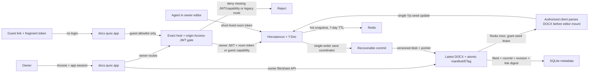

# Spec: Docs personal workspace and share collaboration

> **Trạng thái:** APPROVED TO IMPLEMENT — owner đã review và chốt OQ1–OQ5 ngày 2026-11-22 (xem Owner Decisions bên dưới). Implement theo Task 1→2→3→4; production cutover (Task 4) vẫn là human gate riêng.
> **Pre-spec audit:** một Gemini Flash reviewer độc lập, read-only; findings bên dưới đã được đối chiếu lại với source và ảnh.

## Context Snapshot

- **Project:** fork `nguyendinhquocx/docs`, `D:\pcloud\workspace\code\website\docs.quoc.app`, HEAD `4672d46f`; production `https://docs.quoc.app` trên ProDesk.
- **Stack:** Vite + React + ProseMirror editor; Node/Fastify + Hocuspocus/Yjs collab server trong submodule `collab/`; Redis snapshot storage; `LocalHost` file storage; Docker + Cloudflare Tunnel.
- **Hiện trạng đã xác minh:** `docs.quoc.app` vẫn public (`GET /` HTTP 200), chưa có Cloudflare Access; `CASUAL_PERSONAL_MODE=none`; Web Save tải `.docx` về browser chứ không lưu vào server file store. Editor có autosave IndexedDB nhưng chỉ một slot `current`, không phải thư viện file cá nhân trên server.
- **Share hiện tại:** `ShareDialog` nhận `documentBuffer`; doc mới/template giữ nội dung trong `currentDocument` nên buffer có thể `null` và báo “No document loaded yet”. Khi có buffer, luồng cũ tạo anonymous room, upload seed vào `RoomRegistry` RAM và tạo link `/?room=…&role=edit`. Owner có thể ở single-user mode thay vì join room; `role=edit` là query do client gửi, không phải capability token. Seed/room registry mất khi app process restart, dù Redis còn Y.Doc snapshot.
- **Khôi phục hiện tại:** autosave buffer ở IndexedDB dùng key duy nhất `current`; screenshot cho thấy `Resume.docx` được đề nghị restore trong một doc `Untitled`, nên recovery không gắn đúng document identity.
- **Ảnh owner cung cấp:**

| Ảnh | Surface/state | Evidence |
| --- | --- | --- |
| `D:\pcloud\workspace\obsidian\archive\images\20261122160824.png` | Home + template gallery, desktop | Tên app/hero/GitHub/AI pre-release/credit dư; ligature Material Symbols tràn trên thumbnail và controls; nền xám-lam. |
| `D:\pcloud\workspace\obsidian\archive\images\20261122161154.png` | Editor, blank + recovery state | `Untitled` nhưng banner khôi phục `Resume.docx`; canvas xám; toolbar dày; status “All changes saved” không nói rõ đang lưu ở đâu. |
| `D:\pcloud\workspace\obsidian\archive\images\20261122161347.png` | Share modal trên `/document/new` | “No document loaded yet” dù editor đang có doc mới; mô tả session/drop chưa khớp tính bền vững. |

- **Access facts:** tunnel hiện chỉ route `docs.quoc.app` về `127.0.0.1:8080`; chưa có Access gate hay guest-only route. Cloudflare Access khớp URL path, không khớp query string; vì vậy link `/?room=…` không thể tách riêng khỏi root bằng path policy. WebSocket được Cloudflare hỗ trợ.
- **Personal-mode primitives:** `CASUAL_PERSONAL_MODE=single`, LocalHost file store và SQLite share-link routes đã có nhưng chưa nối vào flow Vite bình thường. Bảng `share_links` hiện lưu token thô; list trả token; metadata/management và Hocuspocus dùng token trong path/query (`?share=`). Không có host-specific HTTP/WS allowlist; một số route có auth riêng nhưng `/api/rooms` và signup/bootstrap vẫn có mặt trên app chung.
- **Save/recovery facts:** `POST /files/:id` cho phép thiếu `If-Match`, check ETag rồi mới ghi nên hai request có thể cùng qua check; LocalHost ghi DOCX, `.meta.json` và SQLite ETag thành các bước riêng. Redis Y.Doc idle TTL hiện 7 ngày; room/seed registry vẫn là `Map` RAM và client seed check không atomic.
- **Desktop boundary:** web Home dùng Material Symbols ligature spans; `index.html` có web font/fallback pipeline. `desk-bridge-bootstrap.ts` vẫn dùng cùng `.woff2` cho desktop offline, nên cleanup web không được xoá font asset hay phá desktop bridge.
- **Relevant sources:** `docx-editor/examples/vite/src/{App.tsx,Home.tsx,collab/Share.tsx,router/index.ts}`, `docx-editor/examples/vite/index.html`, `docx-editor/{bun.lock,packages/react/src/{components/DocxEditor.tsx,components/CasualEditor.tsx,components/TitleBar.tsx,components/AutosaveRestoreBanner.tsx,file-source/**,i18n/**}}`, `collab/{package-lock.json,src/{index.ts,rooms.ts,yjs.ts,storage.ts,auth/personal.ts,files/personal-files-routes.ts,files/personal-shares-routes.ts}}`. Hocuspocus Provider/Server hiện pin 2.15.3 trong hai lockfile.
- **External evidence:** [Cloudflare Access application paths](https://developers.cloudflare.com/cloudflare-one/access-controls/policies/app-paths/), [Cloudflare JWT validation at origin](https://developers.cloudflare.com/cloudflare-one/access-controls/applications/http-apps/authorization-cookie/validating-json/), [Cloudflare WebSockets](https://developers.cloudflare.com/network/websockets/), [Hocuspocus authentication](https://tiptap.dev/docs/hocuspocus/guides/authentication), [Hocuspocus server hooks](https://tiptap.dev/docs/hocuspocus/server/hooks), [Hocuspocus server methods](https://tiptap.dev/docs/hocuspocus/server/usage).

## Owner Decisions (2026-11-22)

| OQ | Quyết định | Chi tiết |
| --- | --- | --- |
| OQ1 Owner identity | Email cá nhân `quocnguyent10v@gmail.com` | Team domain Cloudflare Access cấu hình lúc cutover qua runtime settings (`CF_ACCESS_TEAM_DOMAIN`), không hardcode vào source. |
| OQ2 Server repo | Duyệt fork `nguyendinhquocx/collab` | Giữ remote `upstream` trỏ `CasualOffice/collab`; trỏ submodule sang fork trước khi sửa collab. **Resolved push (2026-11-22, owner chốt qua ask_user):** chọn private mirror. EP đã commit toàn bộ thay đổi collab lên branch `feat/docs-personal-workspace` và push tới `https://github.com/nguyendinhquocx/collab.git` (private; mirror `main` cùng code); `.gitmodules` trỏ mirror. Remote `origin` submodule vẫn trỏ `CasualOffice/collab` để nhận upstream. Lưu ý cutover: clone mirror private ở ProDesk cần credential riêng (gh token hoặc SSH deploy key). |
| OQ3 Owner sign-in | Access + app session (2 lớp) | Yêu cầu owner: app session giữ tối thiểu 30–60 ngày trước khi phải đăng nhập lại (session cookie dài hạn + Cloudflare Access session duration tương ứng lúc cutover). |
| OQ4 Guest host | `docx.quoc.app` | Owner chọn hostname riêng cho guest share (thay khuyến nghị `docs-share` ban đầu); không Access, chỉ phục vụ link hợp lệ. DNS/tunnel tạo ở cutover sau human gate. |
| OQ5 Agent auth | Agent trong browser owner | Agent thao tác trong editor đã owner-authenticated, quyền = owner trust boundary; không cấp client riêng trong V1. |

## Objective

Biến `docs.quoc.app` thành workspace DOCX riêng của mày: người không được mời không vào được workspace; mày có thể lưu và mở lại tài liệu; guest nhận đúng một link, không phải đăng nhập, sửa realtime cùng mày và agent; refresh hoặc app restart không làm mất tài liệu đã báo lưu. Đồng thời thay lớp giao diện hiện tại bằng UI-Q calm/white-first có tiếng Việt, giữ nguyên năng lực chỉnh sửa DOCX cốt lõi.

## Scope

### In

- Owner-only workspace ở `docs.quoc.app`; một owner, file cá nhân lưu bền trên ProDesk `/data`.
- Guest share riêng từng document bằng server-enforced edit capability; guest không cần account và không nhìn thấy Home, file list hay các document khác.
- Owner tự ở trong cùng room sau khi share; owner, guest và agent cập nhật chung một Y.Doc.
- Save/autosave, file identity, room/seed recovery qua browser reload và app/container restart; trạng thái save chỉ thành công sau khi server xác nhận.
- Home, editor, Share dialog, auth/recovery states, template cards và mọi route web đang dùng: simplify + UI-Q; tiếng Việt và English; theme light/dark; tên `Docs`; Tabler `file-text` icon/favicon.
- Gỡ Google Analytics và public indexing metadata khỏi private workspace; giữ nguyên LICENSE/NOTICE và attribution bắt buộc trong source/docs.

### Out

- Multi-account team/organization, member ACL, view/comment role, public marketing/SEO, phát triển AI/DocOps feature, đổi engine sang OpenDoc hoặc thay ProseMirror/Yjs.
- Restyle Tauri/desktop offline host như một sản phẩm riêng; shared component thay đổi không được làm desktop regress.
- Tự tạo/sửa upstream repo hoặc Cloudflare policy trước khi owner duyệt spec và xác nhận các human-gate inputs.

## UX Baseline

1. **Keyboard:** Tab đi theo thứ tự thị giác; Enter kích hoạt action; Esc đóng menu/dialog; focus trở lại trigger.
2. **Focus:** keyboard focus phải nhìn thấy; không black ring khi pointer; không xóa focus state nếu chưa có cue thay thế.
3. **A11y:** label gắn input; error liên kết đúng field; text contrast ≥4.5:1; controls ≥44px; guest state có screen-reader announcement.
4. **Viewport:** không tràn ngang 320→1440px; gallery, editor toolbar và share route reflow được.
5. **States:** empty/loading/saving/saved/error/offline/invalid-link/revoked/recovery phải nói trạng thái thật + đường phục hồi.
6. **Nhất quán:** dùng token/UI-Q và shared component; không thêm framework CSS thứ hai; không hardcode màu rải rác.
7. **Theme:** trên web chỉ Light/Dark; default Light; choice được nhớ; không tự đổi theo OS và không hover tooltip cho nút theme. Desktop offline ngoài scope giữ nguyên hành vi/system mode.
8. **Copy:** mọi UI string theo locale; “Saved” chỉ sau server ack; không dùng text marketing hoặc status nội bộ.

## User Flow — hiện tại → mục tiêu

- **Hiện tại:** vào root public → Home template gallery → tạo doc giữ trong React state hoặc mở file → Share có thể lỗi vì thiếu `documentBuffer`; khi Share thành công, owner phải tự chọn Join session, guest vào room query link; Save trên web tải file xuống máy.
- **Mục tiêu:** owner qua Access → mở/thêm tài liệu trong file library → sửa và thấy trạng thái server-save → Share tạo capability + room từ đúng state hiện tại và tự join owner → guest mở share host không đăng nhập → owner/guest/agent thấy cùng một luồng edit → reload/restart vẫn phục hồi phiên bản đã lưu.
- **Advanced path:** import/export `.docx`, đổi locale/theme, thu hồi hoặc gia hạn link. Không phơi các tuỳ chọn này trước khi user cần.
- **Recovery:** draft cục bộ cũ vẫn có thể khôi phục đúng document; không bao giờ đưa `Resume.docx` vào một `Untitled` khác hoặc tự xoá draft khi đổi file.

## Thuật ngữ

- **Owner workspace:** giao diện và file list chỉ owner truy cập sau auth.
- **Guest capability:** token server-issued, chỉ cấp quyền edit một file/room; không phải account.
- **Room:** Y.Doc/Hocuspocus document được các client mở chung.
- **Seed:** DOCX bytes ban đầu cần để khởi tạo editor; phải đọc lại được sau restart.
- **Owner agent:** agent được owner-authorize để sửa cùng room; không phải account đa người dùng.

## Assumptions

1. Một owner account; guest chỉ qua capability link, quyền duy nhất trong V1 là edit.
2. UI mặc định tiếng Việt; vẫn có English switch; nội dung tài liệu không bị dịch.
3. Link guest mặc định hết hạn sau 30 ngày và owner có thể revoke sớm; renew tạo token mới.
4. Capability là 32-byte CSPRNG; SQLite chỉ lưu digest. Raw token chỉ trả một lần khi mint; list link trả `linkId`/metadata, không trả lại secret. Link dùng fragment; HTTP gửi `Authorization` header; Hocuspocus dùng provider token channel. Không token trong path/query/access log/referrer.
5. Mặc định agent thao tác trong owner-authenticated browser/editor, không nhận `cs_session` hay token owner trong chat/log. Agent trong browser là owner principal; quyền này rộng như owner, không phải guest-scoped identity. Nếu cần agent client độc lập, OQ5 phải chốt room-scoped credential trước T2.
6. Latest DOCX đã commit là recovery fallback; Redis Y.Doc snapshot có thể hết hạn sau 7 ngày chỉ khi snapshot miss/expiry dựng lại được từ DOCX mới nhất theo revision. Không ghi “Saved” trước khi durable commit hoàn tất.
7. Test/upgrade dùng fixture riêng; không restart production nếu còn owner room đang hoạt động.

## Open Questions — cần owner chốt ở lần review spec

1. **Owner identity/Access:** email hoặc stable identity claim nào được allowlist? Chốt Cloudflare team domain, owner app AUD và claim allowlist cho origin JWT validation; không lấy email từ runtime tự động làm authority. Cấu hình ở owner-controlled dashboard/secret-free runtime settings.
2. **Server repo ownership:** các yêu cầu durable seed/token-save cần sửa `collab/` submodule đang trỏ upstream `CasualOffice/collab`. Khuyến nghị fork `nguyendinhquocx/collab`, giữ remote `upstream`, rồi trỏ submodule sang fork. Owner có duyệt tạo fork thứ hai không? Nếu không, phải chọn upstream PR/merge và phần durable bị block tới khi upstream nhận.
3. **Owner sign-in:** đề xuất Access owner allowlist + app `CASUAL_PERSONAL_MODE=single` để file ownership/save dùng sẵn. Hai session có thể cần đăng nhập riêng; nếu bắt buộc một login duy nhất thì cần Access-JWT→app-session bridge, scope lớn hơn. Chọn phương án trước T1.
4. **Guest host:** đề xuất hostname mới `docx.quoc.app` (NXDOMAIN ở lần kiểm tra 2026-11-22), cùng tunnel nhưng không Access; app-host guard chỉ phục vụ link hợp lệ. Nếu mày muốn giữ một hostname duy nhất, phải thiết kế riêng path-based Access bypass cho SPA/assets/API/WebSocket.
5. **Agent auth:** mặc định agent thao tác trong owner browser và chịu owner trust boundary. Mày có chấp nhận quyền owner rộng đó không, hay agent cần một client riêng chỉ có quyền `fileId + roomId`? Nếu cần client riêng, phải cấp capability ngắn hạn qua local secure channel; không gửi link/session secret vào chat.
6. **Existing share state:** trước migration inventory `users.db`, files và share rows. `CASUAL_PERSONAL_MODE=none` nghĩa là user DB chưa được mở/tạo bởi app; known anonymous room registry hiện 0 sau test restart, nhưng phải xác nhận lại tại cutover. Legacy `?room=` links bị invalidate vì room/seed đã mất. Nếu có personal share rows, dừng cutover, backup và owner chọn reissue hay hash migration; không tự âm thầm revoke/giữ plaintext.

## Approach

- **Owner surface:** giữ `docs.quoc.app` sau Cloudflare Access allowlist; app dùng `CASUAL_PERSONAL_MODE=single` cho owner file ownership/session. Access phải hoạt động trước signup/bootstrap đầu tiên. Chỉ host owner được vào Home, `/auth/*`, file library, share management và owner settings; `/health` chỉ loopback/internal, không public qua host nào.
- **Host boundary:** cùng Fastify process có exact-host allowlist cho `docs.quoc.app` và `docx.quoc.app`; Host chỉ là routing hint, không phải bằng chứng danh tính. Mọi owner-host HTML/static/API và raw WebSocket upgrade (`/yjs`, `/api/ai`) bắt buộc validate `Cf-Access-Jwt-Assertion` tại origin: RS256 signature qua Cloudflare JWKS, exact issuer/team domain, owner-app AUD, `exp`/`nbf` và owner identity claim. Kiểm tra cả static fallback/health-adjacent paths, không chỉ API handlers; header presence hoặc Host match một mình không đủ. Guest host không có Access JWT, nên chỉ guest allowlist + capability. Unknown host reject. Test request từ guest ingress cố set `Host: docs.quoc.app`; thiếu/sai JWT không được trả owner HTML/API dù edge route bị cấu hình sai.
- **Guest surface:** `docx.quoc.app` không có Access nhưng chỉ phục vụ static share shell, token-scoped `/api/share/**` resolve/seed/save và `/yjs` có capability hợp lệ. Chặn `/auth/*`, owner `/files/**`, share-management CRUD, admin, WOPI, `/api/ai`, `/api/rooms/**` legacy, `/health` và mọi WS thiếu token. Owner host cũng tắt anonymous room creation/read/write; sửa `?role=edit` hoặc đoán room ID không cấp quyền. Không chỉ ẩn route trong React.
- **Capability lifecycle/transport:** guest link có `https://docx.quoc.app/#share=<token>`; fragment không gửi lên server. Mint trả raw token một lần với `Cache-Control: no-store`; store chỉ lưu digest. Link-list trả `linkId` + role/expiry/status, không trả secret; owner quản lý/revoke theo `linkId`, không để token trong path. Guest HTTP dùng `Authorization: Bearer`; lock Hocuspocus Provider/Server theo đúng version `2.15.3` trong lockfile, provider `token` phải đi trong authentication message sau WSS upgrade, server đọc `onAuthenticate({ token })`/`onTokenSync`, không đọc token từ `requestParameters`/query. Integration test bắt `WebSocket.url` thực tế và assert không chứa guest/owner token; nếu pinned version đưa token vào URL thì dùng custom auth frame hoặc one-time secure HttpOnly ticket exchange, tuyệt đối không fallback token-in-query. Owner browser gọi `POST /files/:id/collab-token` bằng owner session để lấy short-lived signed room token bound `ownerId + fileId + roomId + role + exp` với issuer/audience riêng; signing key chỉ nằm trong ProDesk secret config, không trong repo/compose/logs. `cs_session` không gửi vào WS hay agent tool, room token chỉ ở memory. Thêm redaction, `Referrer-Policy: no-referrer`, `Cache-Control: no-store` và không ghi token raw vào logs.
- **Revoke đang active:** revoke/expiry có hiệu lực ngay, không chỉ chặn lần join kế tiếp. Đánh dấu capability revoked trước, sau đó revalidate đúng các WS connection mang `linkId` đó qua `onTokenSync`/`connection.requestToken()` nếu API có trong version đã pin; nếu không, thêm server connection registry theo `socketId + linkId` và đóng đúng socket. Token invalid phải terminate socket; read-only chỉ là bước tức thời trước close, không thay thế disconnect. Không gọi `closeConnections(roomId)` vì sẽ đuổi owner và các guest link khác. Revoke response chỉ thành công sau khi guest socket đã đóng; các room participant khác tiếp tục làm việc.
- **Migration:** trước khi bật personal mode, backup `users.db`, file store và Redis; inventory user/file/share rows. Nếu DB vắng/rỗng thì khởi tạo schema v2 hash-only. Nếu có share rows legacy, dừng cutover cho owner chọn hash-migrate hay revoke/reissue; không giữ plaintext compatibility column và không âm thầm đổi link. Legacy anonymous `/?room=…&role=edit` links bị reject, không chuyển sang guest host. Schema hash mới không downgrade tại chỗ: rollback phải restore bộ DB + file + Redis snapshot đồng bộ và reissue links được mint sau backup.
- **Room/file identity:** mỗi saved file có stable `fileId` và `roomId` persisted; tất cả share links của file bind vào đúng cặp đó. Share từ blank/template serialize state hiện tại, tạo file trước, rồi tạo room/link. Owner tự join room. Sau restart, server resolve metadata từ SQLite/file store, không cần room còn trong `RoomRegistry` Map.
- **Seed/recovery:** DOCX→ProseMirror/Y.XmlFragment conversion tiếp tục ở authorized browser client bằng parser hiện có (`parseDocx` → `toProseDoc` → `prosemirrorToYXmlFragment`); không thêm parser/dependency vào collab server. Khi Redis snapshot miss/expired hoặc revision cũ hơn file ETag, server cấp một atomic seed lease theo `roomId + fileRevision`; chỉ lease holder được lấy DOCX seed và import vào Y.Doc trước khi mount `DocxEditor`. Client khác ở loading, không mount/insert; chúng chờ Yjs sync và trạng thái `seededRevision`. Server đánh dấu seed xong sau khi Yjs update đã được persist. Nếu lease holder chết/hết hạn, server kiểm tra fragment/revision; nếu seed update chưa commit thì cấp lease mới, nếu đã commit thì không import lần hai. Room metadata/lease dùng shared persistent coordination (không RAM-only) để nhiều process không tranh nhau. Redis idle TTL 7 ngày chỉ được giữ vì cache miss rebuild từ latest committed DOCX theo protocol này; test Redis expiry, lease holder crash và hai client simultaneous.
- **Shared save:** Y.Doc là live collaborative state; một per-room single-writer coordinator/election chọn peer đã sync để serialize state mới nhất thành DOCX. Chỉ một commit in-flight cho mỗi file; writer lease có failover. Mỗi commit dùng room revision + ETag bắt buộc; stale snapshot bị reject, peer phải sync rồi serialize lại — không retry mù. Mọi peer nhận cùng revision/Save state.
- **Durable commit:** DOCX blob + file metadata + ETag/manifest phải thành một recoverable atomic commit (ví dụ versioned blob + atomic pointer, hoặc journal/recovery protocol tương đương). Không coi nhiều `writeFile`/SQLite calls là atomic. “Saved” chỉ sau commit; lỗi/crash giữa bước phải phục hồi nhất quán hoặc hiện pending/error. Một revision chưa ACK có thể được replay từ Redis nếu snapshot còn, nhưng không được gọi là Saved trước DOCX commit.
- **Owner agent:** mặc định agent thao tác trong owner-authenticated editor, cùng Y.Doc với guest; agent không nhận session secret ngoài browser. Owner WS token chỉ scope `fileId + roomId`, không cấp file-list API. Nếu owner yêu cầu agent client riêng, cấp token ngắn hạn bound `fileId + roomId` qua local secure channel, không dùng broad `cs_session` và không gửi token qua chat.
- Giữ một nguồn ProseMirror/Y.Doc: import seed một lần vào fragment trước khi mount editor; `externalContent` và plugin wiring phải nhất quán, không parse/overwrite hai lần.
- UI direction: Operate app, UI-Q Calm + Owner UI Baseline; code-led, không thêm canvas/tournament. Update `DESIGN.md` từ kết quả đã verify ở cuối, không tạo design system thứ hai.
- Cloudflare Access không thể phân biệt query `?room=`; guest subdomain tránh public hoá root. Nếu owner chọn một hostname, phải viết lại path-policy, asset/API/WS allowlist và negative test trước khi implement.

## Diagram

## Bỏ qua

- Không giữ public home/marketing banner, upstream GitHub links, fake “All changes saved”, Google Analytics, hoặc raw Material Symbols ligature text.
- Không thêm comment-only/view-only roles, team invitations, multi-tenant signup, Access bypass trên `/?room=` query, hoặc share UI mở guest vào owner file library.
- Không xoá/đổi LICENSE/NOTICE, không thay template document content, không đổi desktop/Tauri flow ngoài regression fix bắt buộc.
- Không đưa password, Access token, share token, cookie hoặc bootstrap credential vào source, compose, chat hay test log.

## Risks

- **Cross-repo:** persistence/auth endpoints thuộc `collab/`; fork/ownership phải chốt trước khi sửa submodule.
- **Host bypass:** hai hostname vào cùng Fastify/raw-WS process; SPA route guard hoặc Host match không đủ. Owner origin phải xác thực full Cloudflare JWT claims; guest ingress spoof Host phải bị chặn; route gate áp dụng trước handler/upgrade.
- **Access/bootstrap:** nếu mở `single` signup trước Access, outsider có thể claim account đầu tiên. Access phải được xác minh trước bootstrap; health/internal route không được bypass public.
- **Two auth layers:** Access + app session có thể tạo hai lần sign-in; không được lén thay bằng public root để giảm bước.
- **Share secret/migration/revoke:** token raw hiện nằm trong SQLite, list response và URL path/query; WS provider wire chưa được xác nhận tại runtime. Hash migration, no-token-URL test, old-link policy, immediate active-socket revoke, no-store/no-referrer và log redaction phải cùng một cutover plan.
- **Multiwriter/data loss:** ETag hiện optional và check-then-write; LocalHost bytes, sidecar và SQLite ETag không atomic. Cần coordinator/CAS + recoverable commit, không chỉ retry UI.
- **Room recovery:** RoomRegistry Map + seed endpoint RAM-only; Redis Y.Doc idle TTL 7 ngày. Client hiện parse DOCX và seed bằng check non-atomic; expiry/miss cần lease/claim để đúng một client parse + import trước editor mount, không restore stale snapshot hay duplicate.
- **Agent scope:** owner session có quyền với cả workspace; chỉ dùng nó cho agent nếu owner xác nhận đây là trust boundary. Agent client riêng phải bị giới hạn file/room.
- **Deploy/rollback:** selfhost compose hiện là ProDesk production recipe, bind `/data` và Redis volume thật. Staging phải có project/volume/port riêng; DB/token migration rollback cần backup cùng file/Redis/tunnel config.
- **Desktop regression:** `DocxEditor`/`TitleBar` shared với offline `deskApp`; web-only theme/icon changes cần desktop smoke và giữ icon font offline đang dùng.
- **Public state hiện tại:** production đang public, không có Access, `CASUAL_PERSONAL_MODE=none`. Spec chưa được implement; không đưa tài liệu nhạy cảm lên trước khi Access + storage gates pass.

## Task List

### Task 1 — Owner-only identity và file workspace

- **Acceptance:**
  - `docs.quoc.app` không trả SPA/Home/API cho browser chưa qua Access; chỉ owner allowlist vào được. `/health` không public; chỉ container-local healthcheck dùng được.
  - App ở `CASUAL_PERSONAL_MODE=single`; một account owner duy nhất, không mở multi signup; first-account bootstrap xảy ra sau Access gate.
  - Home mở file library của owner, tạo doc mới, mở, đổi tên và lưu DOCX trên LocalHost `/data`; saved status chỉ lên sau server ack.
  - Browser-local autosave/recents hiện hữu không bị xoá; import/recovery của file cũ là explicit và gắn đúng document identity.
  - Save → refresh / sign out-in → cùng file và nội dung vẫn còn; server/container restart → owner library vẫn còn.
- **UX Contract:** login/empty/loading/error/saving/saved states; error có retry; Saved chỉ sau HTTP success; restore banner chỉ cho đúng document; keyboard/Esc/labels/focus theo UX Baseline; không hiện file list ở share host.
- **Skills:** `ui-design`, `flow`, `frontend-taste-chatgpt`, `mobile-responsive`.
- **Visual Ref:** ảnh `20261122161154.png`; UI-Q canonical `D:\.claude\skills\ui-design\references\ui_q_direction.md`; source pattern `CasualEditor.tsx` + `PersonalFileSource`.
- **Reproduce:** `cd docx-editor && bun run typecheck && bun test packages/react/src/file-source`.
- **Verify:** Playwright tests cho owner Access gate, first-account signup closure, personal file CRUD, ETag, refresh/restart; unauth browser nhận Access challenge/deny; owner browser thấy file.
- **Files:** `docx-editor/examples/vite/src/App.tsx`, `Home.tsx`, `router/index.ts`; `docx-editor/packages/react/src/components/CasualEditor.tsx`; `packages/react/src/file-source/**`; `collab/src/auth/personal-routes.ts`, `files/personal-files-routes.ts`, `host/local.ts`; `deploy/docker-compose.selfhost.yml`.

### Task 2 — Capability share, host boundary và durable collaboration

- **Acceptance:**
  - Owner Share từ blank/template/file đang sửa serialize live editor state, tạo/persist file nếu là draft, bind stable `fileId + roomId`, mint guest token và tự đưa owner vào đúng room. Owner app session lấy Hocuspocus room token ngắn hạn qua owner-authenticated `POST /files/:id/collab-token`; token chỉ scope đúng owner/file/room/role/expiry.
  - Enforce exact-host route matrix server-side trước Fastify routes/static fallback/raw WS upgrade. Owner host yêu cầu Cloudflare Access **và** origin-verified `Cf-Access-Jwt-Assertion` (signature/JWKS, issuer, audience, owner identity, `exp`/`nbf`) cùng app session; legacy anonymous create/seed/snapshot/WS bị tắt. Guest host không Access, chỉ static share shell, token-scoped `/api/share/**` và `/yjs` capability; chặn `/auth/*`, owner `/files/**`, admin, WOPI, `/api/ai`, `/api/rooms/**`, `/health`, unknown routes.
  - Gọi trực tiếp `/api/rooms`, `/api/rooms/:id/seed`, `/auth/signup`, `/files`, admin, WOPI, `/api/ai`, `/health` và WS từ guest host đều bị từ chối; Host spoof/unknown host bị từ chối. `?role=edit`, `?role=write`, `?share=` hay room ID không thay capability.
  - Guest link chỉ dùng fragment `#share=`; HTTP token ở `Authorization` header. Provider/Server `2.15.3` phải gửi WS auth qua authentication message sau upgrade; Playwright/WS integration assert URL không có guest/owner token. Owner WS token chỉ mint từ owner session, scope `ownerId + fileId + roomId + role + exp`, và handshake owner còn phải có valid CF Access JWT. Nếu provider version đưa token vào URL, test FAIL và không ship cho tới khi có secure auth-frame/cookie exchange, không dùng query fallback. DB guest token lưu `token_hash`/digest, raw token trả một lần; list chỉ trả `linkId` + metadata; update/revoke dùng `linkId`, không token trong path. Invalid/expired/revoked/wrong-file token không đọc seed, không join WS và không save. Token không có trong request URL, access/referrer/app logs.
  - Kiểm tra/migrate DB trước cutover: backup trước schema change; hash-only schema không giữ plaintext compatibility column. Legacy anonymous room links bị reject; nếu có share rows cũ thì migrate/reissue theo OQ6, có rollback bằng restore DB + file + Redis snapshot nhất quán.
  - Room/file mapping bền qua process restart. Khi Redis snapshot miss/expired/stale, server cấp atomic seed lease theo `roomId + fileRevision`; đúng một authorized browser client parse DOCX bằng editor parser hiện có và import Y.XmlFragment trước khi mount editor. Peer khác chờ, không mount/seed. Server đánh dấu `seededRevision` sau khi update persist; lease holder crash → lease timeout rồi retry có kiểm tra fragment, không duplicate. Redis snapshot cũ không được ghi đè revision file mới; collab server không tự parse DOCX.
  - Một per-room single-writer coordinator serialize Y.Doc đã sync; chỉ một commit/file đang chạy, lease failover được. Commit bắt buộc expected ETag + room revision; stale snapshot bị reject và reserialize từ state mới, không retry mù. DOCX bytes + metadata/ETag được commit atomic hoặc journal/recover tương đương; Saved chỉ sau commit; crash injection không để bytes/metadata lệch.
  - Revoke/expiry có hiệu lực ngay với socket đang mở: server đánh dấu `linkId` revoked, revalidate đúng connection qua `onTokenSync`/`requestToken` (nếu có ở pinned version) hoặc registry theo `socketId + linkId`, rồi đóng/đặt read-only riêng socket đó. Revoke response chỉ thành công sau khi guest mất quyền; owner và guest dùng link khác vẫn ở room.
  - Agent mặc định sửa trong owner-authenticated editor, cùng Y.Doc và trust boundary của owner, không gửi session secret qua chat. Nếu OQ5 chọn agent client riêng, phải dùng credential ngắn hạn bound `fileId + roomId` và test không thể list/open file khác.
- **UX Contract:** share state empty (blank doc vẫn share được), preparing/loading, copied (in-place feedback), invalid/expired/revoked, reconnecting/offline, saving/failed. Guest shell chỉ có document + presence + share/recovery cần thiết; không home/create menu.
- **Skills:** `flow`, `ui-design`, `mobile-responsive`.
- **Visual Ref:** ảnh `20261122161347.png`; owner/guest flow từ this spec; capability policy trong Approach.
- **Reproduce:** `cd collab && npm test && npm run typecheck`.
- **Verify:** integration fixture: create owner file → mint short-lived owner room token + guest capability → owner + two guests edit concurrently while owner-agent edits through the owner editor → same room revision and DOCX commit. Test owner CF JWT missing/invalid/signature/aud/issuer/expiry, owner token expired/wrong-file/wrong-room, and Host spoof through actual guest ingress returns no owner content. Pin Hocuspocus 2.15.3; inspect actual WS upgrade URL and assert no auth token; assert token reaches `onAuthenticate({ token })` via auth message. Revoke link L1 while L1 guest + owner + L2 guest are online: L1 socket is closed before revoke response; owner/L2 stay live; L1 cannot reconnect. A transient read-only state is not accepted as successful revoke. Seed lease race: one client gets lease/parses; loser does not mount/insert; kill winner before/after Yjs commit and prove retry does not duplicate. Also test two writes with same ETag, stale reserialize, crash between blob/manifest, restart, Redis expiry, legacy token migration/rollback fixture and host route matrix. Không chạy test này trên production data.
- **Files:** `collab/src/{index.ts,rooms.ts,yjs.ts,storage.ts,auth/personal.ts,auth/personal-routes.ts,auth/join-role.ts,files/personal-files-routes.ts,files/personal-shares-routes.ts,host/local.ts}`; `docx-editor/examples/vite/src/{collab/Share.tsx,App.tsx,router/index.ts}`; `packages/react/src/{collab/useCollab.ts,file-source/useFileSourceAutoSave.ts}`; staging-safe fixture/tests. **Write boundary phụ thuộc OQ2 collab fork; agent credential phụ thuộc OQ5.**

### Task 3 — Vietnamese, Docs identity, home/editor UI-Q

- **Acceptance:**
  - `vi.json` covers all Vite app + `DocxEditor` user-facing keys with parity against `en.json`; `scripts/validate-i18n.mjs validate` passes. Language selector persists per owner/browser; documents' own text is untouched.
  - Mọi visible string, tooltip/title, menu item và `aria-label` trên web owner/guest surfaces lấy từ locale keys. Đặc biệt các TitleBar hardcodes hiện có (`Bold`, `Italic`, `Underline`, `Strikethrough`, `Small Caps`, `All Caps`, `Show ruler`, `Vertical ruler`, `Spell check`, `Spelling`, `Grammar check`, `Voice typing`, `Menus`) phải được key hoá và dịch; `Theme: match system` bị bỏ khỏi web, Light/Dark labels được dịch. JSON parity một mình không đủ gate.
  - Browser tab ở Home là chính xác `Docs`; khi mở document giữ pattern `<document name> — Docs` để phân biệt nhiều tab. Native desktop window title không đổi. Favicon và app mark dùng local Tabler outline `file-text`; locale cập nhật `html[lang]`.
  - Remove visible “Casual Editor”, GitHub/`schnsrw/docx`, pre-release AI banner/learn-more, old MIT/Gateway footer và stale author/Go/`docs.casualoffice.org` metadata. Remove Google Analytics. Keep LICENSE/NOTICE/source attribution.
  - Home giữ personal files/recents, New/Open và template search/gallery; template hiện SVG/Tabler hoặc không có icon, không bao giờ lộ ligature text. Gỡ web-only `@font-face`, `.material-symbols-outlined`, `.fonts-loaded` và fallback script khỏi `examples/vite/index.html`; thay Home spans bằng SVG. Giữ `desk-bridge-bootstrap.ts` và `.woff2` asset cho offline desktop, trừ khi thay riêng desktop path và smoke pass.
  - Home, editor, auth/share/recovery và guest view dùng UI-Q white-first; toolbar grouped theo task; web theme chỉ Light/Dark, default Light, không `auto`/hover tooltip. Desktop system theme behavior giữ nguyên.
  - Existing DOCX editing functions, shortcuts and document content remain intact.
- **UX Contract:** Owner and guest surfaces are `Operate`, not marketing. Empty/loading/error/recovery, selected/focus/disabled, saving/offline and invalid-link states covered. Use system sans; white surfaces; calm controls; no promotional copy; keyboard focus visible; `aria-label` replaces tooltip; 320/375/768/1280/1440 widths no overflow. See 8-item UX Baseline.
- **Skills:** `ui-design`, `flow`, `frontend-taste-chatgpt`, `mobile-responsive`, `impeccable` (UI-Q is already selected; no new direction tournament).
- **Visual Ref:** owner screenshot packet `D:\pcloud\workspace\obsidian\archive\images\20261122160824.png`, `...\20261122161154.png`, `...\20261122161347.png`; UI-Q contract; app-owned `DESIGN.md` documented from verified result at finish.
- **Reproduce:** `cd docx-editor && bun run i18n:validate && bun run typecheck && bun test`.
- **Verify:** browser captures of owner home, template gallery, blank editor, populated editor, share modal, guest room, invalid link, light/dark, Vietnamese/English; compare with supplied images. Playwright kiểm exact Home/editor tab titles, favicon, recovery identity, share states, no raw ligature; render TitleBar menus/theme control ở `vi` và assert không còn các English labels liệt kê trong acceptance. `i18n:validate` chỉ kiểm JSON parity, không thay test render. Quét web build không còn font/fallback pipeline hoặc ligature spans; giữ `.woff2` cho desktop. Mobile overflow matrix + desktop smoke: mở DOCX offline, edit, save, đóng/mở lại; Share/collab vẫn tắt và system theme không đổi.
- **Files:** `docx-editor/examples/vite/index.html`, `src/main.tsx`, `src/App.tsx`, `src/Home.tsx`, `src/styles.css`, `src/templates/manifest.ts`, `public/{favicon.svg,logo.svg}`, `packages/react/i18n/{en.json,vi.json}`, `packages/react/src/i18n/**`, `packages/react/src/components/{TitleBar.tsx,DocxEditor.tsx}`; `DESIGN.md` at repo root after visual verification. `src/desk-bridge-bootstrap.ts`/desktop font asset chỉ đọc hoặc giữ nguyên trừ khi có desktop-specific approval.

### Task 4 — Isolated staging, Access/tunnel cutover và rollback

- **Acceptance:**
  - Owner host `docs.quoc.app` có Cloudflare Access owner policy **và** origin kiểm JWT `Cf-Access-Jwt-Assertion`; guest host `docx.quoc.app` không Access nhưng chỉ expose token-scoped guest flow qua host gate. Health chỉ loopback; app không mở public host port.
  - Thêm **standalone** `deploy/docker-compose.staging.yml` (không `-f` overlay với production compose), Compose project name riêng, bind mount riêng `../data/staging/collab:/data`, Redis volume `docs-quoc-app-staging-redis-data` và port duy nhất `127.0.0.1:18080:8080`. Không gắn `../data/collab`, Redis `redis-data` production, tunnel, hay credentials thật.
  - Trước `up`, `docker compose config` phải chứng minh đúng project/port/volume; không được chạy base selfhost command trong ProDesk production clone để test.
  - Production Access/DNS/tunnel mutation là cutover riêng sau human gate; exact-host Access owner policy được cài trước bootstrap. Share host không có Access nhưng server-side allowlist vẫn bắt buộc.
- **Reproduce — hai checkpoint tách biệt, không chain:** (1) Preflight read-only: `docker compose -p docs-quoc-app-staging -f deploy/docker-compose.staging.yml config` từ repo root; inspect toàn bộ rendered config và lưu receipt, xác nhận đúng port `127.0.0.1:18080`, bind path `../data/staging/collab`, Redis volume riêng, không `../data/collab`/8080/tunnel/secret. (2) Chỉ sau khi người kiểm tra xác nhận preflight PASS mới chạy riêng `docker compose -p docs-quoc-app-staging -f deploy/docker-compose.staging.yml up -d --build`. Không dùng `--quiet`, không gộp config và up bằng `&&`, không test trên ProDesk production clone.
- **Verify:** trên staging fixture, test exact-host + origin JWT matrix (signature/issuer/AUD/owner claim/expiry), custom `Host` từ guest ingress, owner login, guest no-login, invalid token, WebSocket, seed lease/save/revoke/restart/Redis expiry; health chỉ `localhost`. Trước production cutover lưu image digest, compose và tunnel config trước thay đổi, backup `users.db` + DOCX/metadata + Redis snapshot; test restore/rollback trên staging, ghi receipt; kiểm tra listener chỉ `127.0.0.1`. Không public `/health`. Production cutover chỉ sau approval cuối; không chạy test restart trên data thật.
- **Files:** `deploy/docker-compose.selfhost.yml`, `deploy/docker-compose.staging.yml`, `deploy/README.md`, `deploy/receipts/**`, ProDesk runtime tunnel config/unit (secret-free reference + backup receipt only); outer fork `.gitmodules` nếu collab fork được duyệt.

## Checkpoints

1. **Before implementation:** owner resolves OQ1–OQ5; inventory OQ6; Access team/AUD/owner identity, guest host, collab write ownership và agent trust boundary explicit.
2. **After Task 1:** unauth owner host blocked; owner-only library/save/reload persists; no guest host endpoint can enumerate files or bootstrap owner.
3. **After Task 2:** direct-host route matrix passes; capability hash/migration/rollback passes; concurrent save/atomic commit, Redis expiry fallback and seed race tests pass; owner/guest/agent approved path shares one room.
4. **After Task 3:** vi/en, title/menus, web-only icon cleanup, responsive/focus tests and desktop offline smoke pass.
5. **Before release:** isolated staging UAT + restore/rollback pass; Access/tunnel route and no-inbound-port checks pass; no raw token in URL/log/referrer; health remains internal. Production cutover only after explicit final approval of reviewed spec and Access identity.

## External Review Brief

### Reviewer cần phán

- Có đúng hai access class không: owner-only workspace và anonymous edit-only per-document guest?
- Guest host có server-side host allowlist cho HTTP + raw WS không; owner host còn cryptographically verify Access JWT (issuer/AUD/expiry/identity) không; guest ingress giả Host owner có bị chặn ở origin không?
- Token digest/API migration có tránh lộ token trong DB/list/path/query/log/referrer không; pinned provider có giữ token ngoài WS URL không; rollback giữ được file/room state không?
- Revoke một link có đóng đúng các socket của link đó ngay mà không làm rớt owner/link khác không?
- `LocalHost` file, Redis Y.Doc, share-token table và save coordinator có cùng revision/source-of-truth sau refresh/restart/Redis expiry không?
- DOCX→Y.Doc conversion do ai làm; seed lease có guarantee đúng một client parse/import trước khi mount editor, kể cả lease holder crash không?
- Concurrent writers, file+metadata commit và first-seed bootstrap có race/crash test đủ bắt data loss không?
- Owner-agent scope có rõ (owner trust vs file/room-scoped) và guest không thể enumerate file không?
- UI flow có để owner ở ngoài room, share buffer bị stale, restore sai file, hardcoded English hay desktop regress không?
- Vietnamese key parity, screenshots, Responsive/User Test và task verify có bắt lỗi thật không?

### Reviewer nên đọc trước

`deploy/README.md`, `deploy/docker-compose.selfhost.yml`, `docx-editor/examples/vite/src/{App.tsx,Home.tsx,collab/Share.tsx,router/index.ts,desk-bridge-bootstrap.ts}`, `docx-editor/{bun.lock,packages/react/src/{components/CasualEditor.tsx,components/DocxEditor.tsx,components/TitleBar.tsx,components/AutosaveRestoreBanner.tsx,file-source/**,i18n/**}}`, `collab/{package-lock.json,src/{rooms.ts,index.ts,yjs.ts,storage.ts,auth/personal.ts,auth/personal-routes.ts,auth/join-role.ts,files/personal-files-routes.ts,files/personal-shares-routes.ts,host/local.ts}}`; Cloudflare official URLs in Context Snapshot; all three owner screenshots.

### Reviewer không cần phán

Không phán style direction tournament (UI-Q/Calm đã được owner gọi); không đề xuất thay Yjs/ProseMirror/OpenDoc; không thiết kế multi-user SaaS, comment-only roles hoặc AI features.

## User Test

| Hành động | Kết quả kỳ vọng | Chuẩn nhìn |
| --- | --- | --- |
| Mở `docs.quoc.app` ở browser không đăng nhập | Owner Access block/redirect, không thấy Home/file list | Không xuất hiện template, tên file hay editor trước auth |
| Đăng nhập owner rồi mở lại một DOCX đã lưu | File hiện trong workspace và nội dung đúng | Status “Đã lưu” chỉ sau server ACK; không restore nhầm `Resume.docx` vào `Untitled` |
| Tạo blank doc/template rồi bấm Share | Tạo file/link thành công, owner ở ngay trong room | Không có “No document loaded yet”; link không lộ token trong query |
| Mở share link ở browser sạch/no cookies | Vào đúng một tài liệu, không cần đăng nhập; trang chính không lộ | Không thấy Home/list/create; link hết hạn/revoke thì không thấy nội dung |
| Gọi trực tiếp owner routes từ `docx.quoc.app` hoặc giả `Host: docs.quoc.app` qua guest ingress | Bị reject; guest shell vẫn hoạt động | Owner HTML/API/WS không trả dữ liệu nếu Access JWT thiếu/sai issuer/AUD/identity; `/auth`, `/files`, admin, WOPI, `/api/ai`, `/api/rooms`, `/health` bị chặn |
| Revoke một link khi guest đang online | Socket của capability đó bị đóng trước khi revoke trả PASS | Owner và guest dùng link khác vẫn co-edit bình thường; guest revoked không đọc/sửa tiếp và không reconnect được |
| Hai guest mở room cùng lúc sau Redis miss/expiry | Một client nhận seed lease, parse DOCX trước editor mount; client kia chờ Yjs sync | Chỉ một Yjs seed update; lease holder crash không tạo nội dung trùng |
| Sửa cùng lúc ở guest và owner editor | Hai edit merge vào cùng revision; coordinator commit một DOCX snapshot | Stale ETag bị từ chối/resync; không mất đoạn nào; Saved chờ durable commit |
| Save/reload hoặc restart test stack rồi mở lại link | Nội dung đã xác nhận Saved vẫn còn | Redis snapshot hết TTL vẫn dựng lại từ latest DOCX; link không 404/blank |
| Browser tab title và locale | Home là `Docs`; editor là `<tên tài liệu> — Docs`; vi/en đúng | Nhiều tab phân biệt được; TitleBar/menu/aria-label không còn English hardcode khi chọn vi |
| Chuyển ngôn ngữ và theme | Tiếng Việt/English; web Light/Dark only | Không còn Auto/tooltip; desktop offline vẫn dùng system theme |
| Mở mọi template card | Có thể đọc tên/preview và chọn được | Không có chuỗi `outgoing_mail`, `folder_open`, `science`… tràn lên thumbnail |

5 câu Y/N:
1. Người chưa có owner Access hoặc gọi owner API từ guest host có bị chặn không?
2. Guest mở đúng link không cần account và chỉ thấy đúng shared document không?
3. Hai peer sửa đồng thời, save rồi refresh/restart có giữ đủ nội dung mới nhất không?
4. Giao diện Home/editor/share có khớp UI-Q/ảnh và vẫn đọc được trên mobile, không làm desktop offline regress không?
5. Home tab/editor tab đúng tên, web theme đúng 2 trạng thái và mọi UI label/error đều tiếng Việt khi chọn vi không?

## Completion Gates

- [ ] Owner Access + origin JWT validation (signature/issuer/AUD/owner claim/expiry) + single-account bootstrap an toàn; guest host spoof không mở owner routes.
- [ ] Pinned Hocuspocus auth không đưa credential vào WS URL; share token hash-only, trả một lần, link CRUD không lộ secret; migration/legacy-link policy và rollback có receipt.
- [ ] Revoke active link ngắt đúng session ngay; owner/guest/agent theo OQ5 sync realtime.
- [ ] DOCX→Y.Doc seed lease client-side atomic trước editor mount; Redis expiry fallback và winner/timeout tests PASS.
- [ ] Single-writer/CAS + atomic recoverable commit; concurrent stale-write, crash giữa commit, Redis expiry và atomic seed tests PASS.
- [ ] Staging Compose config được render/inspect riêng trước `up`; project/port/file volume/Redis volume tách riêng; restore/rollback test pass trước production cutover.
- [ ] `bun run verify`, `bun run i18n:validate`, server `npm test`/typecheck và Playwright share/persistence/route/i18n suites PASS.
- [ ] UI screenshot/focus/responsive/i18n/invalid-link state thật; desktop offline open/edit/save/reopen smoke PASS; owner UAT PASS.
- [ ] Owner phê duyệt Access identity, guest host, collab fork, agent scope và production cutover; receipt cập nhật.

**Dừng:** đã cập nhật 2026-11-22 — implement được phép theo Task 1→2→3 sau khi owner chốt OQ1–OQ5 (xem Owner Decisions). Production cutover (Task 4) cùng mọi mutation Cloudflare/DNS/tunnel/`CASUAL_PERSONAL_MODE`/submodule trên production vẫn là human gate riêng chờ owner duyệt; OQ6 (inventory share state) chốt tại cutover.
